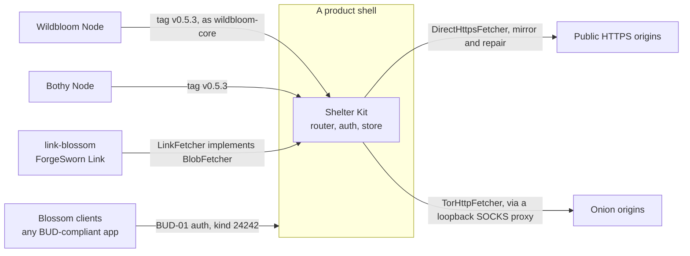

# Where Shelter Kit fits

Shelter Kit is the storage core shared by two products. It turns Blossom
uploads into content-addressed, quota-bound, retention-ordered storage, and it
mirrors and repairs blobs through whatever fetcher the product supplies. It
never owns a listener, a transport or a consent model: Wildbloom Node and Bothy
Node each supply those around the same router and store.

## Neighbours

| Neighbour | Relationship | Interface | Status |
| --- | --- | --- | --- |
| [Wildbloom Node](https://github.com/forgesworn/wildbloom-node) | product shell | git tag `v0.5.3`, renamed `wildbloom-core`; mounts `router()` on its own listener, serves over a Tor onion or direct HTTPS | production candidate; paid storage is not enabled in a released Node |
| Bothy Node | product shell | git tag `v0.5.3`; mounts `router()` unchanged on authenticated ForgeSworn Link streams; registers a `BlobFetcher` for `fsl://` mirrors | two-node loopback test only; no acceptance on separate physical devices |
| [ForgeSworn Link](https://github.com/forgesworn/forgesworn-link) | transport library | `link-blossom`'s optional `shelter-kit` feature; its `LinkFetcher` implements `BlobFetcher` | pinned at `v0.5.3` in Link's workspace |
| Blossom clients | callers | BUD-01, 02, 04, 06, 11 and self-only BUD-12 over HTTP; kind 24242 authorisation events | any compliant client |
| HTTPS and onion origins | mirror sources | `DirectHttpsFetcher` (public address space only, redirects off) and `TorHttpFetcher` (loopback SOCKS proxy, redirects off) | supplied adapters |

The shell also supplies policy at runtime: owner keys, friend grants and the
quota (see [Runtime policy](../README.md#runtime-policy)). Each product maps
its own vocabulary onto owner, friend and guest; the core records a claim's
`class` label but never acts on it.

## What Shelter Kit leaves to others

- Opening a port, running Tor, NAT traversal, STUN or TURN.
- Encrypting application data before upload.
- Publishing Nostr identity, status or service events.
- Discovering peers, choosing replicas or promising a replica count.
- Resolving `fsl://` addresses: the adapter validates the node and owns
  consent; the core only refuses credentials, ports, queries, fragments and
  extra path segments.

## Not built yet

- A Link lane for Wildbloom Node; it mirrors over Tor or HTTPS today.
- `fsl://` mirroring between separate physical devices.

Checked against shelter-kit `2a4b941`, wildbloom-node `eb482b6` and
forgesworn-link `7aad8bf` on 6 November 2026.
